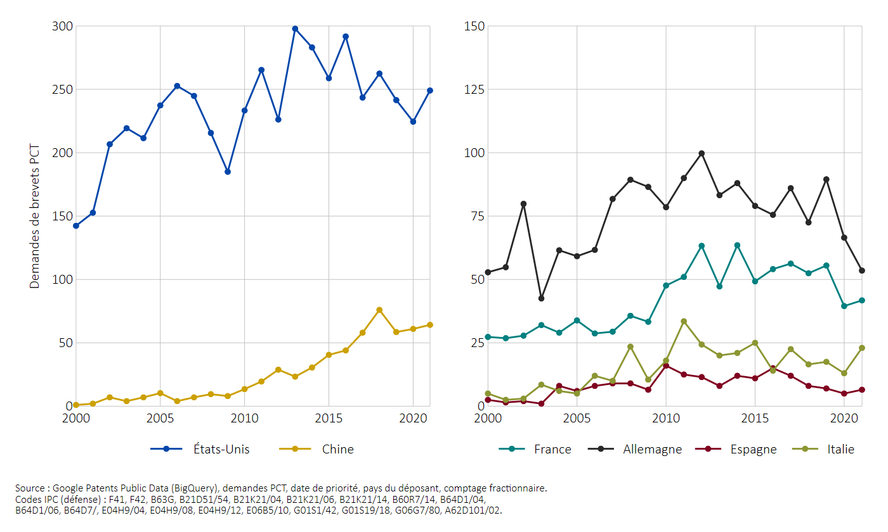

# Technologies à double usage

Ce dépôt rassemble des données et des scripts pour étudier les technologies liées à la défense et au double usage.
Les requêtes SQL exploitent Google Patents Public Data via BigQuery pour compter des demandes de brevets PCT de 2000 à 2021. Elles ciblent 19 codes IPC et couvrent les États-Unis, la Chine, la France, l’Allemagne, l’Espagne et l’Italie. Les demandes attribuées à plusieurs pays sont comptées au prorata du nombre de pays des déposants (comptage fractionnaire), année de priorité.
Le dépôt comprend aussi un panel SIPRI sur les revenus d’armement et hors armement d’entreprises européennes.

